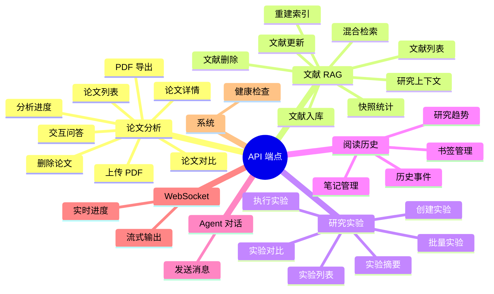

# Silver Research Bot — API 参考

> **读者**: 前端/集成开发者 | **前提**: 了解 REST API 和 WebSocket | **预计阅读**: 20 分钟

本文档列出 Silver Research Bot 的所有 HTTP API 端点和 WebSocket 协议，包含请求格式、响应结构和错误码。

---

## API 概览



---

## 1. 论文分析 API

- **Base URL**: `http://localhost:8765`
- **Content-Type**: `application/json`（上传文件使用 `multipart/form-data`）

### 1.1 上传论文

```
POST /api/paper/upload
```

**请求**: `multipart/form-data`

| 字段 | 类型 | 必填 | 说明 |
|------|------|------|------|
| `file` | File | 是 | PDF / TXT / MD 文件 |

**响应** (201):

```json
{
  "paper_id": "p_a1b2c3d4",
  "filename": "attention_is_all_you_need.pdf",
  "status": "processing",
  "message": "论文已上传，后台开始分析"
}
```

上传后立即返回，分析在后台异步执行。

### 1.2 论文列表

```
GET /api/paper/list
```

**响应** (200):

```json
{
  "papers": [
    {
      "id": "p_a1b2c3d4",
      "filename": "attention_is_all_you_need.pdf",
      "title": "Attention Is All You Need",
      "language": "en",
      "pages": 15,
      "stage": "done",
      "status": "completed",
      "created_at": "2026-07-18T10:00:00",
      "updated_at": "2026-07-18T10:03:00"
    }
  ]
}
```

### 1.3 论文详情

```
GET /api/paper/{id}
```

**响应** (200):

```json
{
  "id": "p_a1b2c3d4",
  "filename": "attention_is_all_you_need.pdf",
  "title": "Attention Is All You Need",
  "language": "en",
  "pages": 15,
  "stage": "done",
  "status": "completed",
  "artifacts": {
    "translation": true,
    "system_model": true,
    "problem_formulation": true,
    "optimization_algorithm": true,
    "experiment_design": true,
    "formula_explanations": true,
    "visualization": true,
    "citation_graph": true,
    "review_theory": true,
    "review_engineering": true,
    "review_domain": true,
    "audit": true
  },
  "formulas": [
    {
      "index": 1,
      "latex": "Attention(Q,K,V) = softmax(\\frac{QK^T}{\\sqrt{d_k}})V",
      "page": 3,
      "context": "Scaled Dot-Product Attention"
    }
  ]
}
```

### 1.4 分析进度

```
GET /api/paper/{id}/progress
```

**响应** (200):

```json
{
  "stage": 3,
  "stage_name": "formula_explanation",
  "status": "running",
  "message": "正在解读公式 (5/12)...",
  "updated_at": "2026-07-18T10:32:00"
}
```

状态值: `pending` | `running` | `completed` | `failed`

### 1.5 获取产物内容

```
GET /api/paper/{id}/{artifact_type}
```

artifact_type: `translation` | `system_model` | `problem_formulation` | `optimization_algorithm` | `experiment_design` | `formula_explanations` | `visualization` | `citation_graph` | `review_theory` | `review_engineering` | `review_domain` | `audit`

**响应** (200):

```json
{
  "type": "translation",
  "content": "## 翻译结果\n\n### 摘要\n...",
  "mime": "text/markdown"
}
```

### 1.6 PDF 文件

```
GET /api/paper/{id}/pdf
```

**响应**: PDF 文件流 (`application/pdf`)，用于 PDF.js 阅读器。

### 1.7 审计报告

```
GET /api/paper/{id}/audit
```

**响应** (200):

```json
{
  "passed": false,
  "issues": [
    {
      "severity": "error",
      "dimension": "mathematical_rigor",
      "detail": "第3节声称的时间复杂度未提供严格证明",
      "fix": "建议补充复杂度分析的推导过程"
    }
  ]
}
```

### 1.8 提取的图表

```
GET /api/paper/{id}/figures/{filename}
```

**响应**: 图片文件流。

### 1.9 交互问答

```
POST /api/paper/{id}/ask
```

**请求**:

```json
{
  "question": "这篇论文的创新点是什么？"
}
```

**响应** (200):

```json
{
  "question": "这篇论文的创新点是什么？",
  "answer": "本文的核心创新点包括：1. 提出自注意力机制...",
  "context": ["system_model", "review_domain"]
}
```

### 1.10 删除论文

```
DELETE /api/paper/{id}
```

**响应** (200):

```json
{
  "status": "deleted",
  "paper_id": "p_a1b2c3d4"
}
```

### 1.11 导出论文

```
GET /api/paper/{id}/export
```

**响应**: ZIP 文件流，包含所有分析产物 + 原始 PDF。

### 1.12 论文对比

```
POST /api/paper/compare
```

**请求**:

```json
{
  "paper_ids": ["p_a1b2c3d4", "p_e5f6g7h8"],
  "dimensions": ["problem", "method", "performance"]
}
```

**响应** (200):

```json
{
  "comparison": {
    "problem": "两篇论文解决的问题高度相关...",
    "method": "论文A使用Transformer架构，论文B使用GNN...",
    "performance": "在相同数据集上，论文A的准确率高2.3%..."
  }
}
```

---

## 2. 文献 RAG API

### 2.1 文献列表

```
GET /api/rag/papers
```

### 2.2 文献入库

```
POST /api/rag/papers
```

**请求**:

```json
{
  "title": "Attention Is All You Need",
  "authors": ["Vaswani, Ashish"],
  "abstract": "...",
  "full_text": "...",
  "tags": ["nlp", "transformer"],
  "year": 2017
}
```

### 2.3 文献更新

```
PUT /api/rag/papers/{id}
```

### 2.4 文献删除

```
DELETE /api/rag/papers/{id}
```

使用 tombstone 软删除机制，数据可恢复。

### 2.5 混合检索

```
POST /api/rag/search
```

**请求**:

```json
{
  "query": "graph neural network attention mechanism",
  "top_k": 5,
  "tag": "gnn",
  "modality": "text",
  "rerank": true
}
```

**响应**:

```json
{
  "results": [
    {
      "id": "rag_001",
      "title": "Graph Attention Networks",
      "score": 0.94,
      "snippet": "...",
      "tags": ["gnn", "attention"],
      "modality": "text"
    }
  ],
  "query_time_ms": 245
}
```

### 2.6 研究上下文

```
POST /api/rag/context
```

### 2.7 快照统计

```
GET /api/rag/snapshot
```

### 2.8 重建索引

```
POST /api/rag/reindex
```

---

## 3. 研究实验 API

### 3.1 实验列表

```
GET /api/research/runs
```

### 3.2 创建实验

```
POST /api/research/run
```

**请求**:

```json
{
  "name": "transformer_ablation",
  "description": "Transformer 消融实验",
  "config": {
    "model": "transformer",
    "epochs": 100,
    "learning_rate": 0.001
  }
}
```

### 3.3 执行实验

```
POST /api/research/run/{id}/execute
```

### 3.4 批量实验

```
POST /api/research/batch
```

**请求**:

```json
{
  "base_config": {"model": "transformer", "epochs": 100},
  "grid": {
    "learning_rate": [0.001, 0.01, 0.1],
    "batch_size": [32, 64]
  },
  "seeds": [42, 123, 456]
}
```

### 3.5 实验摘要

```
GET /api/research/runs/{id}
```

### 3.6 实验对比

```
GET /api/research/compare?ids=run_001,run_002,run_003
```

---

## 4. 阅读历史与趋势 API

### 4.1 历史事件

```
GET /api/history/events
```

**响应**:

```json
{
  "events": [
    {
      "paper_id": "p_a1b2c3d4",
      "action": "view",
      "timestamp": "2026-07-18T10:30:00"
    }
  ],
  "bookmarks": {"p_a1b2c3d4": true},
  "notes": {"p_a1b2c3d4": "公式推导值得细看"}
}
```

### 4.2 记录查看事件

```
POST /api/paper/{id}/view
```

### 4.3 书签操作

```
GET /api/paper/{id}/bookmark
POST /api/paper/{id}/bookmark
```

### 4.4 笔记操作

```
GET /api/paper/{id}/notes
POST /api/paper/{id}/notes
```

POST 请求体:

```json
{
  "text": "这篇论文的方法可以应用到我的研究方向..."
}
```

### 4.5 研究趋势

```
GET /api/trends
```

**响应**:

```json
{
  "trends": {
    "fields": ["NLP", "CV", "GNN", "RL"],
    "counts": [45, 32, 28, 20]
  },
  "heatmap_data": [],
  "timeline_data": []
}
```

---

## 5. Agent 对话 API

```
POST /api/agent/chat
```

**请求**:

```json
{
  "message": "帮我分析最近关于GNN的研究趋势",
  "session_id": "sess_abc123",
  "attachments": []
}
```

**响应** (200):

```json
{
  "reply": "基于最近的文献检索，GNN领域的研究趋势包括...",
  "session_id": "sess_abc123",
  "suggested_actions": [
    {"type": "search_papers", "query": "graph neural network survey 2026"},
    {"type": "open_rag", "tag": "gnn"}
  ]
}
```

---

## 6. WebSocket

### 论文分析进度

```
WS /api/paper/{id}/stream
```

**推送消息类型**:

```json
{"type": "progress", "data": {"stage": 2, "stage_name": "four_dimension_analysis", "status": "running", "message": "正在分析系统模型..."}}
```

```json
{"type": "complete", "data": {"stage": "done", "status": "completed", "paper_id": "p_a1b2c3d4"}}
```

```json
{"type": "error", "data": {"stage": 3, "status": "failed", "message": "LLM 调用超时，请重试"}}
```

消息类型: `progress` | `complete` | `error`

---

## 7. 系统 API

```
GET /api/health
```

**响应** (200):

```json
{
  "status": "ok"
}
```

---

## 8. 错误码

| HTTP 状态码 | 说明 | 常见原因 |
|------------|------|---------|
| **200** | 成功 | — |
| **201** | 创建成功 | 上传论文成功 |
| **400** | 请求参数错误 | 缺少必填字段、文件格式不支持 |
| **404** | 资源不存在 | paper_id 无效、产物尚未生成 |
| **409** | 冲突 | 重复上传相同论文 |
| **422** | 验证失败 | JSON 格式错误、字段类型不匹配 |
| **429** | 请求过多 | LLM API 频率限制 |
| **500** | 服务器内部错误 | LLM 调用失败、文件系统错误 |
| **503** | 服务不可用 | LLM Provider 全部不可用 |

错误响应统一格式:

```json
{
  "detail": "人类可读的错误描述"
}
```

---

## 9. 路由顺序说明

在 `research_app.py` 中，路由注册顺序至关重要。具体路由必须在通配路由之前：

```python
# ✅ 正确：具体路由在前
@app.get("/api/paper/{id}/export")
@app.get("/api/paper/{id}/progress")
@app.get("/api/paper/{id}/audit")
@app.get("/api/paper/{id}/stream")
@app.post("/api/paper/{id}/ask")
@app.get("/api/paper/{id}/{artifact_type}")  # 通配路由最后

# ❌ 错误：通配路由在前会拦截所有具体路由
```
