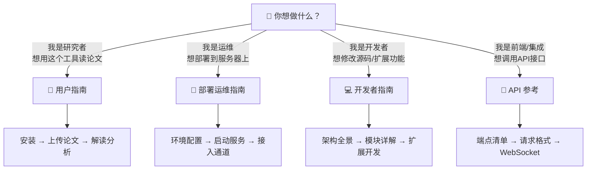

# Silver Research Bot — 项目文档

> **版本**: v0.7.0 | **语言**: 中文为主 | **最后更新**: 2026-07-18

Silver Research Bot 是一个基于 Python 异步架构的 AI Agent 框架，**核心场景为论文研读**。上传 PDF → 自动完成 8 阶段深度分析（翻译→四维分析→公式解读→可视化→引用图谱→A/B审稿→质量审计）。

---

## 文档导航

根据你的身份选择对应文档：

### 核心文档

| 文档 | 读者 | 内容概要 |
|------|------|---------|
| [**用户指南**](./用户指南.md) | 研究者、论文读者 | 项目简介、安装启动、上传论文、8 阶段分析解读、前端功能详解、论文对比、RAG 检索 |
| [**部署运维指南**](./部署运维指南.md) | DevOps、运维人员 | 环境要求、源码安装、LLM Provider 配置（29家）、后端/前端启动、Docker 部署、14 个聊天通道接入、多实例管理、故障排查 |
| [**开发者指南**](./开发者指南.md) | 开发者、贡献者 | 架构全景、目录结构、8 阶段 Pipeline 详解、Agent ReAct 循环、记忆系统、角色工厂、工具系统、前端架构、扩展开发 |
| [**API 参考**](./API参考.md) | 前端/集成开发者 | 论文分析 API、文献 RAG API、研究实验 API、阅读历史 API、Agent 对话 API、WebSocket 协议、错误码 |

### 参考文档

| 文档 | 说明 |
|------|------|
| [configuration.md](./configuration.md) | 完整配置参考，Provider / 记忆 / RAG / 通道设置 |
| [CHANGELOG.md](./changelog/CHANGELOG.md) | 版本变更历史 |
| [pipeline_analysis.md](./pipeline_analysis.md) | 8 阶段 Pipeline 深度分析 |
| [memory.md](./memory.md) | 记忆系统详细说明（遗忘曲线、Dream、冲突检测） |

### nanoBot 框架文档

以下文档面向 nanoBot 底层框架的高级用法，Silver Research Bot 完全兼容：

| 文档 | 说明 |
|------|------|
| [quick-start.md](./quick-start.md) | nanoBot 通用快速开始 |
| [cli-reference.md](./cli-reference.md) | CLI 命令行参考 |
| [chat-apps.md](./chat-apps.md) | 聊天应用接入指南 |
| [chat-commands.md](./chat-commands.md) | 斜杠命令系统 |
| [channel-plugin-guide.md](./channel-plugin-guide.md) | 自定义通道插件开发 |
| [multiple-instances.md](./multiple-instances.md) | 多实例管理 |
| [openai-api.md](./openai-api.md) | OpenAI 兼容 API |
| [python-sdk.md](./python-sdk.md) | Python SDK |
| [websocket.md](./websocket.md) | WebSocket 通道详解 |
| [my-tool.md](./my-tool.md) | 内置 `my` 工具 |
| [deployment.md](./deployment.md) | 原版部署指南 |
| [research-assistant.md](./research-assistant.md) | 研究助手详细说明 |

---

## 快速链接

- **GitHub**: [github.com/silver4444-xs/silver_research_bot](https://github.com/silver4444-xs/silver_research_bot)
- **版本历史**: [CHANGELOG.md](./changelog/CHANGELOG.md)
