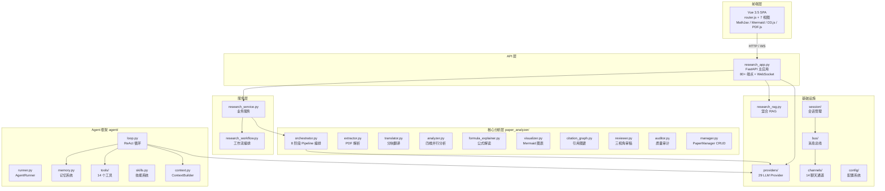
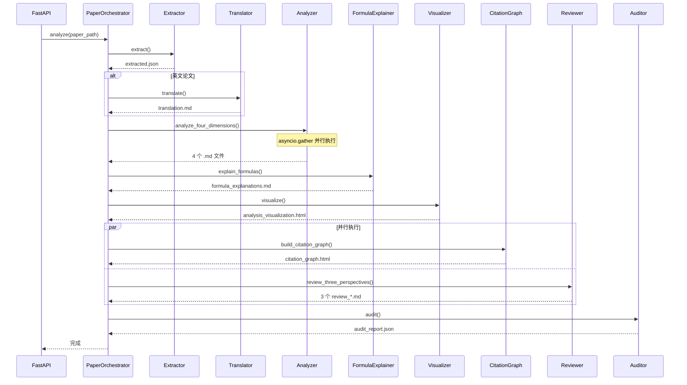
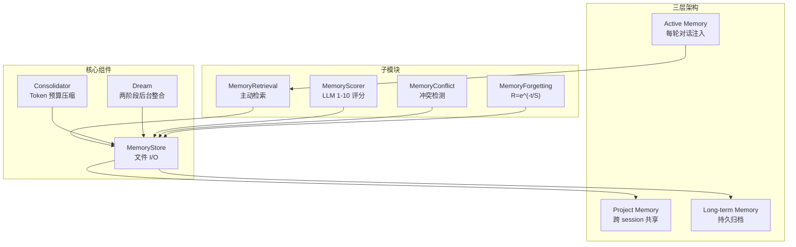
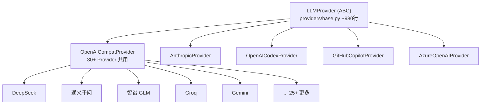
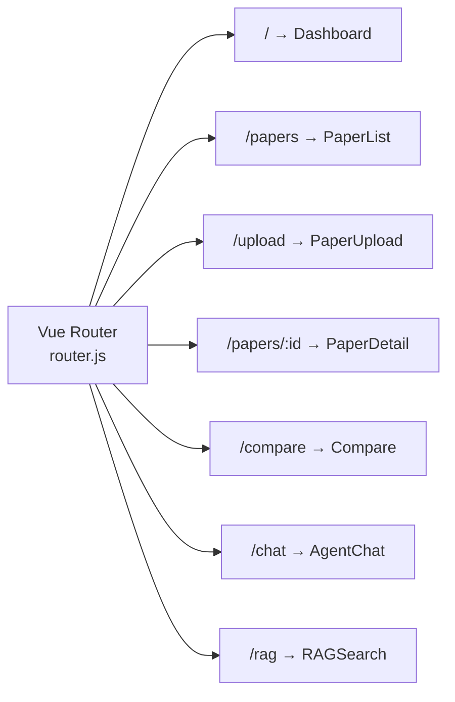

# Silver Research Bot — 开发者指南

> **读者**: 开发者、贡献者 | **前提**: 熟悉 Python asyncio、FastAPI、Vue 3 | **预计阅读**: 35 分钟

本指南深入 Silver Research Bot 的内部架构，帮助你理解核心设计、模块职责和数据流，以及如何扩展新功能。

---

## 1. 架构全景



### 分层职责

| 层级 | 目录 | 职责 |
|------|------|------|
| **前端** | `web/` | Vue 3.5 SPA，深色科技风 UI，CDN 依赖 |
| **API** | `research_app.py` | HTTP 端点 + WebSocket，请求路由 |
| **服务** | `research_service.py`, `research_workflow.py` | 业务逻辑编排 |
| **核心分析** | `paper_analyzer/` | 8 阶段 Pipeline，论文分析全流程 |
| **Agent** | `agent/` | ReAct 循环、记忆、工具、技能 |
| **基础设施** | `providers/`, `config/`, `bus/`, `session/`, `channels/` | LLM 调用、配置、消息、会话、通道 |

---

## 2. 目录结构详解

```
silver_research_bot/               ← Python 包根目录
├── research_app.py                ← FastAPI 主应用 (80+ API端点, 含 WebSocket)
├── research_core.py               ← 通用科研实验引擎
├── research_cli.py                ← CLI 入口
├── research_service.py            ← 业务服务层
├── research_workflow.py           ← 工作流编排
│
├── paper_analyzer/                ← ★ 核心: 论文分析子系统
│   ├── orchestrator.py            ← 8 阶段 Pipeline 编排器
│   ├── extractor.py               ← Stage 0: PDF 解析 (PyMuPDF, 80+ Unicode→LaTeX, 5规则过滤)
│   ├── translator.py              ← Stage 1a: 分块翻译 (3000字/块, 公式占位保护)
│   ├── analyzer.py                ← Stage 1b: 四维并行 asyncio.gather
│   ├── formula_explainer.py       ← Stage 2: 公式批量 LLM 解释 → HTML 卡片
│   ├── visualizer.py              ← Stage 3: 程序化 Mermaid 图表 + 实验表格
│   ├── citation_graph.py          ← Stage 4a: LLM 提取参考文献 → D3.js 力导向图
│   ├── reviewer.py                ← Stage 4b: 三视角 A/B 审稿
│   ├── auditor.py                 ← Stage 5: 结构完整性检查 + LLM 深度审计
│   ├── reproducer.py              ← 可选: 算法伪代码→Python→subprocess 执行
│   ├── manager.py                 ← PaperManager: CRUD + 索引 + 横向对比
│   ├── models.py                  ← AnalysisPlan / PaperAnalysis 数据模型
│   └── tools.py                   ← 论文分析工具辅助
│
├── agent/                         ← nanoBot Agent 基础设施
│   ├── loop.py                    ← AgentLoop 核心 (~1500行): ReAct循环
│   ├── runner.py                  ← AgentRunner: 封装 LLM 调用执行循环
│   ├── context.py                 ← ContextBuilder: 系统提示+历史+记忆+技能
│   ├── memory.py                  ← MemoryStore + Consolidator + Dream (~1140行)
│   ├── autocompact.py             ← AutoCompact: 空闲会话自动压缩
│   ├── hook.py                    ← AgentHook: 钩子系统
│   ├── skills.py                  ← SkillsLoader: 动态技能加载
│   ├── subagent.py                ← SubagentManager: 子代理管理
│   ├── paper_team.py              ← PaperAnalysisTeam: 三Agent协作
│   ├── role_factory.py            ← 5 预定义角色 + SOUL.md 自定义
│   ├── memory_scorer.py           ← LLM 1-10 重要性评分
│   ├── memory_conflict.py         ← 语义冲突检测
│   ├── memory_retrieval.py        ← 主动记忆检索注入
│   ├── memory_forgetting.py       ← 艾宾浩斯 R=e^(-t/S) 遗忘曲线
│   └── tools/                     ← 14 个内置工具
│
├── providers/                     ← LLM Provider 层
│   ├── base.py                    ← LLMProvider ABC (~980行): 统一接口+自动重试
│   ├── openai_compat_provider.py  ← OpenAI 兼容 Provider (30+提供商共用)
│   ├── anthropic_provider.py      ← Anthropic Provider
│   ├── registry.py                ← Provider 注册与自动检测
│   └── ...
│
├── config/                        ← 配置系统
├── bus/                           ← 消息总线
├── session/                       ← 会话管理
├── channels/                      ← 多渠道接入 (14个)
├── templates/                     ← LLM Prompt 模板
├── skills/                        ← 内置技能
├── utils/                         ← 工具函数
└── cli/                           ← CLI 交互
```

---

## 3. 8 阶段 Pipeline 详解

### 3.1 编排器 (Orchestrator)

`paper_analyzer/orchestrator.py` 中的 `PaperOrchestrator` 类负责整个 Pipeline 的生命周期：



### 3.2 各阶段数据流

| 阶段 | 输入 | 处理 | 输出 |
|------|------|------|------|
| **0. 提取** | PDF 文件 | PyMuPDF 逐页解析 + 公式检测 | `extracted.json` |
| **1a. 翻译** | `extracted.json` 全文 | 2000字/块 LLM 翻译 + 公式占位保护 | `translation.md` |
| **1b. 分析** | 翻译后文本 | `asyncio.gather` 并行 4 个 LLM 调用 | 4 个 `.md` 文件 |
| **2. 公式** | 公式列表 | 批量 LLM 四级解释卡片 | `formula_explanations.md` |
| **3. 可视化** | 四维分析结果 | LLM 生成 Mermaid 代码 | `analysis_visualization.html` |
| **4a. 引用** | 参考文献列表 | LLM 提取 + D3.js 渲染 | `citation_graph.html` |
| **4b. 审稿** | 论文全文 | 3 个并行 LLM 审稿 | 3 个 `review_*.md` |
| **5. 审计** | 所有产物 | 结构检查 + LLM 深度审计 | `audit_report.json` |

### 3.3 进度追踪

每个阶段通过 `progress.json` 记录状态：

```json
{
  "stage": 3,
  "stage_name": "formula_explanation",
  "status": "running",
  "message": "正在解读公式 (3/12)...",
  "updated_at": "2026-07-18T10:30:00"
}
```

前端通过轮询（每 2 秒）或 WebSocket 获取进度更新。

---

## 4. Agent 框架详解

### 4.1 ReAct 循环

`agent/loop.py` 实现了完整的 Reasoning + Acting 循环：

```mermaid
sequenceDiagram
    participant BUS as MessageBus
    participant LOOP as AgentLoop
    participant CTX as ContextBuilder
    participant RUN as AgentRunner
    participant LLM as LLM Provider
    participant TOOLS as ToolRegistry
    
    BUS->>LOOP: InboundMessage
    LOOP->>LOOP: _dispatch(msg) 按会话分发
    
    LOOP->>CTX: build_messages()
    CTX->>CTX: 系统提示 + 历史 + 记忆 + 技能
    CTX-->>LOOP: messages[]
    
    LOOP->>RUN: run(messages)
    
    loop ReAct 循环
        RUN->>LLM: chat(messages)
        LLM-->>RUN: response (text / tool_calls)
        
        alt 有工具调用
            RUN->>TOOLS: execute(tool_calls)
            TOOLS-->>RUN: tool_results
            RUN->>RUN: 将结果加入 messages
        else 纯文本响应
            RUN-->>LOOP: 最终响应
        end
    end
    
    LOOP->>LOOP: _save_turn() 持久化
    LOOP->>BUS: publish_outbound()
```

### 4.2 并发控制

```python
# 全局并发限制
global_semaphore = asyncio.Semaphore(3)

# 每会话串行保证
session_locks: dict[str, asyncio.Lock]
```

### 4.3 中轮注入与崩溃恢复

- **中轮注入**: 用户在 LLM 执行中发送新消息 → 插入 `pending_queue` → 下个 tool call 完成后注入
- **崩溃恢复**: 每轮保存检查点（checkpoint）→ 重启后自动恢复到最后检查点

---

## 5. 记忆系统

### 5.1 架构



### 5.2 记忆条目格式

```markdown
<!-- uid:M1 imp:8 ts:2026-06-15T10:30:00 acc:2026-06-15T14:00:00 -->
用户偏好在分析论文时包含数学公式的详细推导。
```

### 5.3 艾宾浩斯遗忘曲线

```python
R = math.exp(-t / S)  # t=距上次访问的时间(天), S=半衰期(7天)
```

---

## 6. LLM Provider 系统

### 6.1 类层次



### 6.2 智能重试机制

- **标准模式**: 指数退避 1/2/4s，最多 3 次
- **持久模式**: 上限 60s，10 次相同错误后退出
- **429 分类**: `rate_limit_exceeded` → 可重试；`insufficient_quota` → 不重试
- **图片降级**: 非临时错误自动移除 base64 图片后重试

### 6.3 添加新 Provider

```python
# 1. 继承 LLMProvider
class MyProvider(LLMProvider):
    async def chat(self, messages, **kwargs):
        ...

# 2. 在 registry.py 注册
register_provider("my_provider", MyProvider)

# 3. 在 config.json 配置
{
  "providers": {
    "my_provider": {"apiKey": "...", "model": "..."}
  }
}
```

---

## 7. 工具系统

### 工具基类

所有工具继承 `agent/tools/base.py` 中的 `Tool` 基类：

```python
class MyTool(Tool):
    name = "my_tool"
    description = "工具描述"
    
    @tool_parameters({
        "param1": StringSchema(description="参数说明", required=True),
    })
    async def execute(self, param1: str) -> ToolResult:
        ...
```

### 内置工具清单

| 工具 | 模块 | 功能 |
|------|------|------|
| `paper_search` | `tools/paper_search.py` | arXiv/PubMed/SemanticScholar/DBLP 并行搜索 |
| `web_search` | `tools/web.py` | Web 搜索 |
| `web_fetch` | `tools/web.py` | 网页内容抓取 |
| `read_file` | `tools/filesystem.py` | 文件读取 |
| `write_file` | `tools/filesystem.py` | 文件写入 |
| `edit_file` | `tools/filesystem.py` | 文件编辑 |
| `list_dir` | `tools/filesystem.py` | 目录列表 |
| `exec` | `tools/shell.py` | 子进程执行 |
| `spawn` | `tools/spawn.py` | 启动子代理 |
| `cron` | `tools/cron.py` | 定时任务 |
| `message` | `tools/message.py` | 主动消息发送 |
| `my` | `tools/self.py` | Agent 自省/配置修改 |
| `mcp` | `tools/mcp.py` | MCP 协议客户端 |
| `sandbox` | `tools/sandbox.py` | 沙箱执行 |

---

## 8. 前端架构

### 8.1 路由结构



### 8.2 Composable 层

| Composable | 职责 |
|-----------|------|
| `useApi` | HTTP 请求封装，统一错误处理 |
| `usePapers` | 论文 CRUD 状态管理 |
| `useCompare` | 论文对比逻辑 |
| `useI18n` | 国际化 zh/en 切换 |
| `useMarkdown` | Markdown 渲染管线 |

### 8.3 前端约束

修改前端代码时务必遵守：

1. **Vue 3 `v-if` + `v-for` 不能同元素** → 用 `<template v-for>` 包裹
2. **不改 CSS class 名称** — `.card` `.navi` `.btn` `.ptrack` `.dtabs` 等
3. **CSS 变量在 `:root`** — `--c-*` 系列，深色科技风
4. **无 Pinia** — 全部用 reactive refs 做状态管理
5. **PDF.js v3.11** 通过 CDN 全局 `pdfjsLib` 访问
6. **D3.js 图表** 在 `nextTick()` 后渲染，resize 防抖 300ms

---

## 9. 消息总线与会话管理

```mermaid
sequenceDiagram
    participant CHAN as 通道 (Telegram/微信等)
    participant BUS as MessageBus
    participant LOOP as AgentLoop
    participant SESS as SessionManager
    
    CHAN->>BUS: InboundMessage
    BUS->>LOOP: consume_inbound()
    LOOP->>SESS: get_or_create_session()
    SESS-->>LOOP: Session
    LOOP->>LOOP: _process_message(msg)
    LOOP-->>BUS: OutboundMessage
    BUS-->>CHAN: 发送响应
```

---

## 10. 扩展开发指南

### 10.1 添加新的分析阶段

```python
# 1. 创建 paper_analyzer/my_stage.py
class MyStageAnalyzer:
    async def analyze(self, paper_data: dict) -> dict:
        ...

# 2. 在 orchestrator.py Pipeline 中注册
await self._update_progress("my_stage", "running")
result = await MyStageAnalyzer().analyze(data)
await self._update_progress("my_stage", "completed")
```

### 10.2 添加新的 Agent 工具

```python
# 1. 创建 agent/tools/my_tool.py，继承 Tool 基类
# 2. 在 agent/tools/registry.py 注册
```

### 10.3 添加新的聊天通道

```python
# 1. 创建 channels/my_channel.py，继承 ChannelBase
# 2. 在 channels/registry.py 注册
```

### 10.4 添加新的分析维度

在 `paper_analyzer/analyzer.py` 中扩展 `asyncio.gather`：

```python
results = await asyncio.gather(
    self._analyze_system_model(text),
    self._analyze_problem_formulation(text),
    self._analyze_optimization_algorithm(text),
    self._analyze_experiment_design(text),
    self._analyze_my_new_dimension(text),  # 新维度
)
```

---

## 11. 测试

```bash
# 全部测试
pytest tests/ -v

# 特定模块
pytest tests/test_translator.py -v

# 带覆盖率
pytest tests/ --cov=silver_research_bot --cov-report=html
```

---

## 12. 编码规范

### Python

- Python 3.11+，充分使用 asyncio 特性
- 遵循 PEP 8，使用 `ruff` 做 linting
- 类型标注：所有公开函数必须有类型标注
- Provider/RAG/Orchestrator 使用懒加载 `_get_xxx()` 模式

### 关键导入关系

- `tool_parameters` 装饰器来自 `agent.tools.base`，**不是** `agent.tools.schema`
- `agent/__init__.py` 触发链: context → loop → autocompact → memory → paper_search → ...

### 前端

- Vue 3 Options API
- 前端依赖全部 CDN 加载（MathJax / Mermaid / D3.js / PDF.js）
