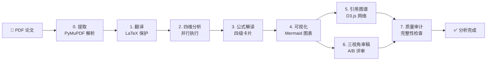
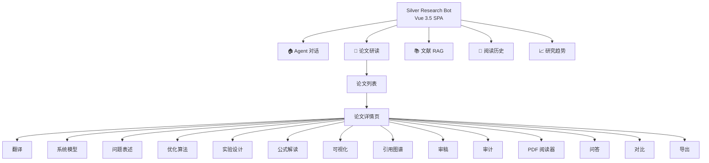
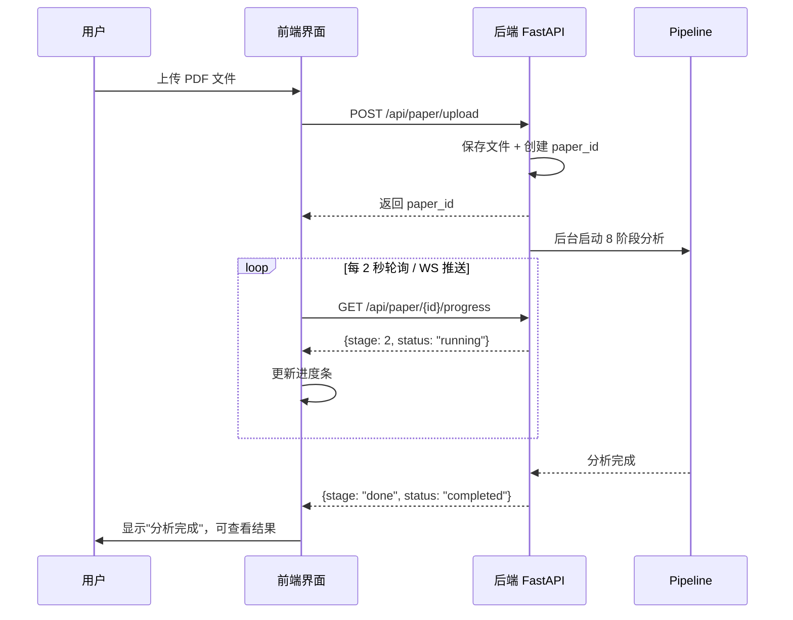
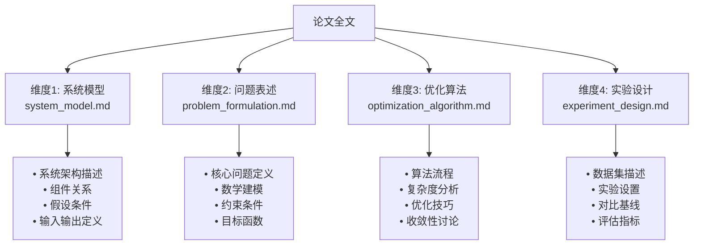
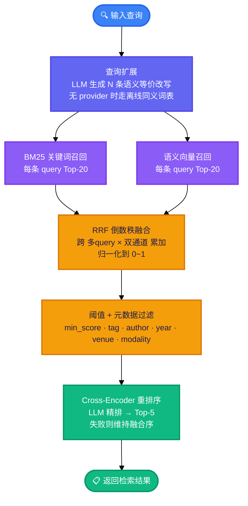

# Silver Research Bot — 用户指南

> **读者**: 研究者、论文读者 | **前提**: 无编程经验要求 | **预计阅读**: 20 分钟

本指南带你从零开始，学会使用 Silver Research Bot 进行论文深度研读。你将了解：安装启动 → 上传第一篇论文 → 解读 8 阶段分析结果 → 使用前端交互功能 → 对比多篇论文 → 利用 RAG 文献检索。

---

## 1. 项目简介

Silver Research Bot 是一个 **AI 驱动的论文深度研读工具**。它不是一个简单的 ChatPDF 替代品——而是对论文进行 8 个阶段的系统化分析，从翻译到审稿，每个阶段产生结构化的深度内容。



### 核心能力一览

| 能力 | 说明 |
|------|------|
| **8 阶段 Pipeline** | 从 PDF 提取到质量审计，全自动深度分析 |
| **LaTeX 保护翻译** | 英文论文翻译为中文，数学公式零损坏 |
| **四维并行分析** | 系统模型、问题表述、优化算法、实验设计同时分析 |
| **公式逐条解读** | 每个公式生成四级 HTML 解释卡片（符号→含义→语境→关联） |
| **引用图谱** | 交互式 D3.js 力导向图，展示论文之间的引用关系 |
| **三视角审稿** | 理论家、工程派、领域专家三个角度独立评审 |
| **论文横向对比** | LLM 增强的多论文对比，8 维度量化评分 |
| **混合 RAG 检索** | 查询扩展 + BM25/向量双路召回 + RRF 融合 + Cross-Encoder 重排 |

### 与 ChatPDF / ChatGPT 的区别

| 对比维度 | ChatPDF / ChatGPT | Silver Research Bot |
|---------|-------------------|---------------------|
| 分析深度 | 单次对话，浅层总结 | 8 阶段结构化深度分析 |
| 公式处理 | 经常丢失或乱码 | 5 规则过滤 + LaTeX 保护翻译 |
| 审稿视角 | 单一视角 | 理论家 / 工程派 / 领域专家三视角 |
| 可视化 | 无 | Mermaid 架构图 + D3.js 引用图谱 |
| 多论文对比 | 手动 | LLM 增强 8 维度横向对比 |
| 记忆能力 | 无 | 艾宾浩斯遗忘曲线，7 天半衰期 |

---

## 2. 快速开始

### 2.1 安装

**方式一：pip 安装（推荐新手）**

```bash
pip install silver-research-bot-ai
```

**方式二：源码安装（推荐开发者）**

```bash
git clone https://github.com/HKUDS/silver-research-bot
cd silver_research_bot
pip install -e ".[dev]"
```

### 2.2 配置 API Key

```bash
cp .env.example .env
```

编辑 `.env` 文件，填入至少一个 LLM Provider 的 API Key：

```ini
# 推荐：DeepSeek（性价比高）
DEEPSEEK_API_KEY=sk-your-key-here

# 或者：OpenAI
OPENAI_API_KEY=sk-your-key-here

# 或者：通义千问（国内首选）
DASHSCOPE_API_KEY=sk-your-key-here
```

### 2.3 启动服务

**启动后端（先执行）：**

```bash
uvicorn silver_research_bot.research_app:app --reload --port 8765
```

看到以下输出表示后端启动成功：

```
INFO:     Uvicorn running on http://127.0.0.1:8765
INFO:     Application startup complete.
```

**启动前端（另一个终端）：**

```bash
cd web
npm install
npm run dev
```

浏览器访问 **http://localhost:5173** 即可看到主界面。

### 2.4 Docker 一键部署

```bash
docker build -t silver-research-bot .
docker run -p 8765:8765 --env-file .env silver-research-bot
```

---

## 3. 前端界面概览

前端是一个深色科技风的单页面应用（SPA），包含 5 个导航标签和 14 个论文详情标签。



### 3.1 5 个导航标签

| 导航 | 功能 |
|------|------|
| **Agent 对话** | 与 AI Agent 自由对话，支持文本 + 文件上传（PDF 自动触发分析） |
| **论文研读** | 核心界面：上传论文、查看列表、打开详情、对比分析 |
| **文献 RAG** | 文献检索库：搜索、入库、管理已索引的论文 |
| **阅读历史** | 时间线展示阅读记录 + 书签管理 + 笔记 |
| **研究趋势** | D3.js 三图：领域柱状图 + 热力图 + 时间折线图 |

### 3.2 国际化切换

界面右上角可一键切换 **中文 / English**，所有界面文字和按钮标签同步切换。

---

## 4. 上传与分析论文

### 4.1 上传论文

在"论文研读"页面，你可以通过以下方式上传：

- **拖拽上传**：将 PDF 文件拖入上传区域
- **点击上传**：点击上传区域选择文件
- **Agent 对话上传**：在对话界面发送 PDF 文件，Agent 会自动触发分析

支持格式：**PDF** / TXT / MD

### 4.2 分析流程

上传后，系统在后台自动启动 8 阶段 Pipeline。你不需要等待——可以关闭页面，分析完成后结果会自动保存。

**进度追踪**：

- 论文列表页面显示每篇论文的当前进度
- 详情页面顶部有进度条，实时展示 8 个阶段的状态
- WebSocket 实时推送进度更新（无需刷新页面）



---

## 5. 八阶段分析结果解读

每篇论文分析完成后，产生 14+ 个产物文件。以下是各阶段的解读指南。

### 阶段 0：PDF 提取

**产物**：`extracted.json`

系统使用 PyMuPDF 深度解析 PDF，提取内容包含：

- **全文文本**：按页组织的完整文章内容
- **公式列表**：通过 5 规则过滤器检测出的所有数学公式
- **图表列表**：从 PDF 中提取的图片（原图无损提取，使用 xref 引用）
- **表格列表**：检测到的数据表格
- **元数据**：标题、作者、语言、总页数

> **技术细节**：系统包含 80+ Unicode→LaTeX 映射表，能将 PDF 中的希腊字母、数学符号等特殊字符转换回 LaTeX 格式。

### 阶段 1a：LaTeX 保护翻译

**产物**：`translation.md`

英文论文自动翻译为中文，核心特色是 **公式零损坏**：

```
原文：The loss function L(θ) = Σ_i (y_i - f(x_i; θ))² + λ||θ||²
译文：损失函数 L(θ) = Σ_i (y_i - f(x_i; θ))² + λ||θ||² 由数据项和正则化项组成
```

翻译策略：
- 每 2000 字一块，前一块的摘要作为上下文传入下一块
- `<FORMULA_i>` 占位符保护每个公式，翻译后原样重建
- 自动检测原文语言，中文论文跳过翻译阶段

### 阶段 1b：四维并行分析

**产物**：4 个 Markdown 文件

系统使用 `asyncio.gather` 同时启动四个 LLM 分析任务：



### 阶段 2：公式解读

**产物**：`formula_explanations.md`

每个公式生成 **四级 HTML 解释卡片**：

| 级别 | 内容 | 示例 |
|------|------|------|
| **L1 符号定义** | 每个符号的含义 | `θ` = 模型参数向量 |
| **L2 数学含义** | 公式表达的核心数学思想 | "该式定义了带有 L2 正则化的均方误差损失" |
| **L3 领域语境** | 在论文中的具体角色 | "用于训练阶段，防止过拟合" |
| **L4 关联关系** | 与论文中其他公式的关系 | "公式(3)是公式(2)中 λ=0 的特例" |

前端使用 **MathJax** 渲染 LaTeX 公式，点击任意公式弹出对应的解释卡片。

### 阶段 3：Mermaid 可视化

**产物**：`analysis_visualization.html`

LLM 分析论文后自动生成：

- **系统架构图**：使用 Mermaid `graph` 绘制
- **算法流程图**：使用 Mermaid `flowchart` 绘制
- **实验对比表格**：HTML 表格，展示方法对比数据
- **关键指标总结**：指标卡片

### 阶段 4a：引用图谱

**产物**：`citation_graph.html`

交互式 D3.js 力导向图，节点分为四类：

| 节点类型 | 颜色 | 含义 |
|---------|------|------|
| **论文** | 🔵 蓝色 | 当前分析的论文 |
| **基础** | 🟢 绿色 | 基础理论/经典方法引用 |
| **对比** | 🟠 橙色 | 作为对比基准的论文 |
| **背景** | ⚪ 灰色 | 背景/综述类引用 |

交互操作：拖拽节点、滚轮缩放、点击查看详情。

### 阶段 4b：三视角审稿

**产物**：3 个 Markdown 文件

三个不同视角的审稿人并行独立评审：

| 视角 | 关注点 | 产物 |
|------|--------|------|
| **理论家** | 理论正确性、数学推导、假设合理性 | `review_theory.md` |
| **工程派** | 可实现性、计算效率、工程落地 | `review_engineering.md` |
| **领域专家** | 创新性、领域贡献、相关工作对比 | `review_domain.md` |

### 阶段 5：质量审计

**产物**：`audit_report.json`

结构完整性检查 + LLM 深度审计，问题按严重性分级：

| 级别 | 说明 | 示例 |
|------|------|------|
| **严重** 🔴 | 影响理解的重大缺陷 | "第3节声称的复杂度未提供证明" |
| **一般** 🟡 | 值得注意的不足 | "消融实验仅覆盖了2个超参数" |
| **建议** 🟢 | 优化建议 | "建议补充在更大数据集上的结果" |

---

## 6. 论文对比

在论文详情页点击"对比"标签，可选择多篇已分析的论文进行横向对比。

系统使用 LLM 增强对比，覆盖以下维度：

| 维度 | 说明 |
|------|------|
| 问题定义 | 各论文解决的核心问题是否相同/互补 |
| 方法论 | 技术路线的异同 |
| 数据集 | 使用的数据集和评估基准 |
| 性能指标 | 关键指标的对比 |
| 创新点 | 各自的核心贡献 |
| 局限性 | 各论文承认的不足 |
| 适用场景 | 各方法最适合的应用场景 |
| 关联关系 | 论文之间的引用/改进关系 |

---

## 7. RAG 文献检索

"文献 RAG" 页面提供文献入库和智能检索功能。

### 7.1 文献入库

通过 `/api/rag/papers` 将论文加入文献库，系统自动：
1. 按标题分段 + token 预算切块（公式/代码/表格块占位保护）
2. BM25 关键词索引
3. 向量嵌入（Embedding）
4. 标注 chunk_type（`text` = 文献正文/标题/摘要，`analysis` = 论文分析产物）

### 7.2 混合检索

检索流程：



---

## 8. 阅读历史与趋势

### 8.1 阅读历史

"阅读历史"页面以时间线形式展示所有操作记录：
- 查看论文、上传论文、书签操作、笔记编辑
- 书签管理：一键收藏/取消
- 笔记功能：每篇论文可编辑私人笔记

### 8.2 研究趋势

"研究趋势"页面包含三个 D3.js 图表：

| 图表 | 说明 |
|------|------|
| **柱状图** | 10 个研究领域的论文数量分布 |
| **热力图** | 领域 × 时间段的热度变化（plasma 色阶） |
| **折线图** | 各领域随时间的研究热度趋势 |

---

## 9. 常见问题

### Q: 支持哪些语言？
论文原文支持英文和中文。英文论文会自动翻译为中文；中文论文跳过翻译阶段直接进入四维分析。

### Q: 分析一篇论文需要多长时间？
取决于论文长度和使用的 LLM Provider。以 30 页英文论文为例，使用 DeepSeek V3 通常需要 3-5 分钟。

### Q: 分析结果保存在哪里？
所有产物保存在 `~/.silver_research_bot/workspace/papers/{paper_id}/` 目录下。可通过"导出"标签一键下载 ZIP 包。

### Q: 可以同时分析多篇论文吗？
可以。每次上传都会创建独立的后台任务，多篇论文并行分析（受 asyncio.Semaphore 并发控制）。

### Q: 公式显示为乱码怎么办？
首先确认论文 PDF 是文字型而非扫描型。扫描型 PDF 需要先 OCR 处理。如果仍有问题，可在详情页的"问答"标签中向 Agent 反馈。

### Q: 需要配置哪些 API Key？
至少配置一个 LLM Provider 的 API Key。推荐 DeepSeek（国内性价比最高）或通义千问。如需 RAG 向量检索功能，还需配置 Embedding Provider。
