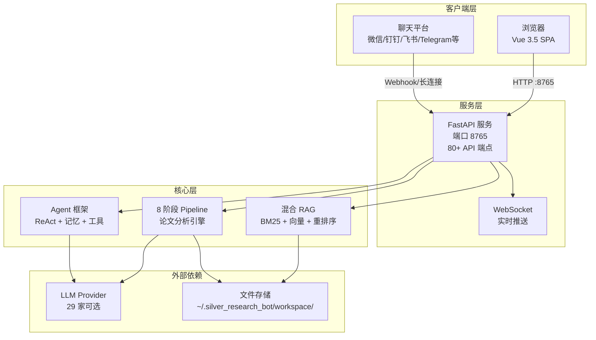
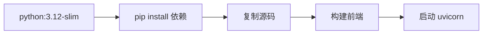
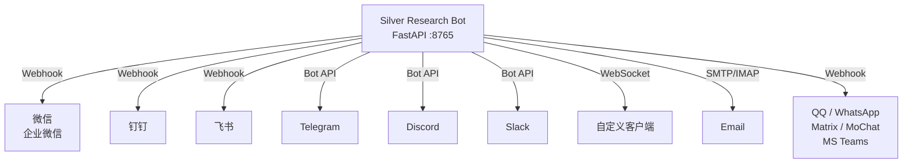

# Silver Research Bot — 部署运维指南

> **读者**: DevOps、运维人员 | **前提**: 熟悉 Linux 命令行、Python 环境 | **预计阅读**: 25 分钟

本指南覆盖 Silver Research Bot 的完整部署流程：环境准备 → 安装配置 → 启动服务 → Docker 部署 → 聊天通道接入 → 多实例管理 → 生产环境优化 → 故障排查。

---

## 1. 系统架构概览



---

## 2. 环境要求

| 组件 | 最低版本 | 推荐版本 | 说明 |
|------|---------|---------|------|
| **Python** | 3.11 | 3.12+ | asyncio 原生支持 |
| **Node.js** | 18 | 20 LTS | 仅前端开发构建需要 |
| **npm** | 9 | 10+ | 前端依赖管理 |
| **pip** | 23 | 24+ | Python 包管理 |
| **磁盘空间** | 2 GB | 10 GB+ | 论文 PDF + 分析产物 + RAG 向量 |
| **内存** | 2 GB | 4 GB+ | 向量检索和 LLM 调用 |
| **操作系统** | Linux / macOS / Windows | Ubuntu 22.04+ | 跨平台支持 |

> **注意**：如果不使用前端（仅 API 模式），Node.js 和 npm 不是必须的。

---

## 3. 安装

### 3.1 源码安装（推荐生产环境）

```bash
# 克隆仓库
git clone https://github.com/HKUDS/silver-research-bot
cd silver_research_bot

# 创建虚拟环境
python -m venv venv
source venv/bin/activate  # Windows: venv\Scripts\activate

# 安装依赖
pip install -e ".[dev]"

# 配置 API Key
cp .env.example .env
vim .env
```

### 3.2 PyPI 安装（简化部署）

```bash
pip install silver-research-bot-ai
```

### 3.3 验证安装

```bash
python -c "from silver_research_bot.research_app import app; print('OK')"
```

---

## 4. LLM Provider 配置

Silver Research Bot 支持 29 家 LLM Provider。至少配置一个才能正常使用。

### 4.1 推荐 Provider

| Provider | 适合场景 | 配置方式 |
|----------|---------|---------|
| **DeepSeek** | 国内，性价比最高 | `.env` 中设置 `DEEPSEEK_API_KEY` |
| **通义千问** | 国内，阿里云生态 | `.env` 中设置 `DASHSCOPE_API_KEY` |
| **智谱 GLM** | 国内，清华系 | `.env` 中设置 `ZHIPU_API_KEY` |
| **OpenAI** | 海外，效果最佳 | `.env` 中设置 `OPENAI_API_KEY` |
| **Anthropic** | 海外，长文本分析 | `.env` 中设置 `ANTHROPIC_API_KEY` |
| **OpenRouter** | 全球，统一接入 | `config.json` 中配置 |

### 4.2 配置方式

**.env 文件（推荐，最简单）：**

```ini
# 至少配置一个
DEEPSEEK_API_KEY=sk-your-deepseek-key
DASHSCOPE_API_KEY=sk-your-dashscope-key
OPENAI_API_KEY=sk-your-openai-key
ANTHROPIC_API_KEY=sk-your-anthropic-key
```

**config.json（高级配置）：**

```json
{
  "providers": {
    "deepseek": {
      "apiKey": "${DEEPSEEK_API_KEY}",
      "model": "deepseek-chat"
    },
    "openai": {
      "apiKey": "${OPENAI_API_KEY}",
      "model": "gpt-4o"
    }
  }
}
```

`${ENV_VAR}` 语法会从环境变量中自动读取，避免在配置文件中硬编码密钥。

### 4.3 环境变量覆盖

配置中的任何字段都可以通过环境变量覆盖：

```bash
export silver_research_bot_providers__deepseek__model="deepseek-reasoner"
export silver_research_bot_agent__max_turns="20"
```

---

## 5. 启动服务

### 5.1 仅后端（API 模式）

```bash
# 开发模式（热重载）
uvicorn silver_research_bot.research_app:app --reload --port 8765

# 生产模式（多 worker）
uvicorn silver_research_bot.research_app:app --host 0.0.0.0 --port 8765 --workers 4
```

验证：`curl http://localhost:8765/api/health` → `{"status":"ok"}`

### 5.2 后端 + 前端

```bash
# 终端 1：启动后端
uvicorn silver_research_bot.research_app:app --reload --port 8765

# 终端 2：启动前端
cd web
npm install
npm run dev
# 浏览器访问 http://localhost:5173
```

### 5.3 使用 systemd（生产环境推荐）

创建服务文件 `/etc/systemd/system/silver-research-bot.service`：

```ini
[Unit]
Description=Silver Research Bot
After=network.target

[Service]
Type=simple
User=ubuntu
WorkingDirectory=/opt/silver_research_bot
EnvironmentFile=/opt/silver_research_bot/.env
ExecStart=/opt/silver_research_bot/venv/bin/uvicorn silver_research_bot.research_app:app --host 0.0.0.0 --port 8765 --workers 4
Restart=on-failure
RestartSec=5

[Install]
WantedBy=multi-user.target
```

启动服务：

```bash
sudo systemctl daemon-reload
sudo systemctl enable silver-research-bot
sudo systemctl start silver-research-bot
sudo systemctl status silver-research-bot
```

### 5.4 Nginx 反向代理

```nginx
server {
    listen 80;
    server_name your-domain.com;

    # 前端静态文件
    location / {
        root /opt/silver_research_bot/web/dist;
        try_files $uri $uri/ /index.html;
    }

    # API 反向代理
    location /api/ {
        proxy_pass http://127.0.0.1:8765;
        proxy_http_version 1.1;
        proxy_set_header Upgrade $http_upgrade;
        proxy_set_header Connection "upgrade";
        proxy_set_header Host $host;
        proxy_set_header X-Real-IP $remote_addr;
        proxy_read_timeout 300s;
    }

    # WebSocket
    location /ws/ {
        proxy_pass http://127.0.0.1:8765;
        proxy_http_version 1.1;
        proxy_set_header Upgrade $http_upgrade;
        proxy_set_header Connection "upgrade";
        proxy_read_timeout 86400s;
    }
}
```

---

## 6. Docker 部署

### 6.1 Dockerfile 结构



### 6.2 构建与运行

```bash
# 构建镜像
docker build -t silver-research-bot .

# 运行容器
docker run -d \
  --name silver-research-bot \
  -p 8765:8765 \
  --env-file .env \
  -v ~/.silver_research_bot:/root/.silver_research_bot \
  silver-research-bot

# 查看日志
docker logs -f silver-research-bot
```

### 6.3 Docker Compose

`docker-compose.yml`：

```yaml
version: "3.8"
services:
  app:
    build: .
    ports:
      - "8765:8765"
    env_file:
      - .env
    volumes:
      - workspace:/root/.silver_research_bot/workspace
      - ./config.json:/root/.silver_research_bot/config.json
    restart: unless-stopped

volumes:
  workspace:
```

```bash
docker-compose up -d
```

---

## 7. 聊天通道接入

Silver Research Bot 支持 14 个聊天平台，让你可以在微信、钉钉、飞书、Telegram 等平台上使用 AI Agent。



### 7.1 通用接入步骤

1. 在目标平台创建 Bot 应用，获取 Token / Webhook URL
2. 在 `config.json` 中配置对应通道
3. 启动时自动注册通道

### 7.2 Telegram 配置示例

```json
{
  "channels": {
    "telegram": {
      "enabled": true,
      "token": "${TELEGRAM_BOT_TOKEN}"
    }
  }
}
```

### 7.3 企业微信配置示例

```json
{
  "channels": {
    "wecom": {
      "enabled": true,
      "corpId": "${WECOM_CORP_ID}",
      "agentId": "${WECOM_AGENT_ID}",
      "secret": "${WECOM_SECRET}",
      "token": "${WECOM_TOKEN}",
      "encodingAESKey": "${WECOM_AES_KEY}"
    }
  }
}
```

> 详细的通道配置请参考 [chat-apps.md](./chat-apps.md) 和各通道的独立文档。

---

## 8. 工作区与数据管理

### 8.1 工作区结构

```
~/.silver_research_bot/workspace/
├── papers/                  ← 论文分析产物
│   ├── index.json           ← PaperManager 索引
│   └── p_<uuid>/            ← 单篇论文目录
│       ├── original.pdf     ← 原始文件
│       ├── extracted.json   ← 解析结果
│       ├── progress.json    ← 分析进度
│       ├── translation.md   ← 翻译产物
│       ├── analysis_*.md    ← 四维分析
│       └── ...              ← 其他产物
├── research/                ← 通用实验运行
├── research_rag/            ← RAG 索引
│   ├── index.json
│   ├── corpus.jsonl
│   └── vectors/             ← numpy 向量存储
├── reading_history.json     ← 阅读历史
└── memory/                  ← Agent 记忆系统
    ├── MEMORY.md
    └── history.jsonl
```

### 8.2 备份与恢复

```bash
# 备份工作区
tar -czf workspace-backup-$(date +%Y%m%d).tar.gz ~/.silver_research_bot/workspace/

# 恢复
tar -xzf workspace-backup-20260718.tar.gz -C ~/
```

### 8.3 磁盘清理

```bash
# 查看各论文占用空间
du -sh ~/.silver_research_bot/workspace/papers/*/

# 删除指定论文（也可通过 API 操作）
curl -X DELETE http://localhost:8765/api/paper/{paper_id}
```

---

## 9. 多实例管理

当需要运行多个独立的 Silver Research Bot 实例时：

```bash
# 实例 A（论文分析专用）
silver_research_bot --workspace ~/.silver_bot_papers --port 8765

# 实例 B（代码审阅专用）
silver_research_bot --workspace ~/.silver_bot_code --port 8766
```

每个实例拥有独立的工作区、配置和记忆系统。详见 [multiple-instances.md](./multiple-instances.md)。

---

## 10. 安全建议

| 措施 | 说明 |
|------|------|
| **使用反向代理** | Nginx / Caddy 在前面处理 TLS 终止 |
| **环境变量管理密钥** | 永远不要在 `config.json` 中硬编码 API Key |
| **限制端口暴露** | 后端端口 `8765` 只监听 `127.0.0.1`，由 Nginx 代理 |
| **定期更新** | `pip install -U silver-research-bot-ai` |
| **文件权限** | `.env` 文件权限设为 `600` |
| **防火墙** | 仅开放 80/443 端口，8765 仅本地访问 |

---

## 11. 故障排查

### 后端启动失败

```bash
# 检查端口占用
lsof -i :8765
# 或 Windows: netstat -ano | findstr :8765

# 检查 Python 版本
python --version  # 需要 3.11+

# 检查依赖
pip list | grep -E "fastapi|uvicorn|pydantic"
```

### LLM 调用失败

```bash
# 验证 API Key 是否配置
grep -E "API_KEY" .env

# 测试网络连通性（以 DeepSeek 为例）
curl -H "Authorization: Bearer $DEEPSEEK_API_KEY" \
  https://api.deepseek.com/v1/models
```

### 前端白屏

- 确认后端已启动并可访问：`curl http://localhost:8765/api/health`
- 检查 Vite 代理配置：`web/vite.config.js` 中 proxy 指向 `127.0.0.1:8765`
- 清除浏览器 Service Worker 缓存（开发时 SW 应禁用）

### 内存不足

```bash
# 降低 worker 数量
uvicorn ... --workers 2  # 而非 4

# 清理旧的分析产物
rm -rf ~/.silver_research_bot/workspace/papers/p_old_uuid/
```

### 分析卡在某个阶段

- 检查 `progress.json`：`cat ~/.silver_research_bot/workspace/papers/{paper_id}/progress.json`
- 查看后端日志中的错误信息
- 尝试切换 LLM Provider（某些 Provider 可能响应不稳定）
- 通过 API 重新触发分析：`POST /api/paper/{id}/ask`
